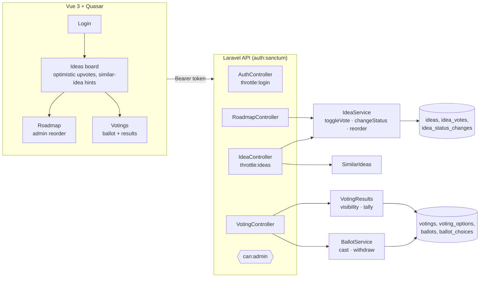
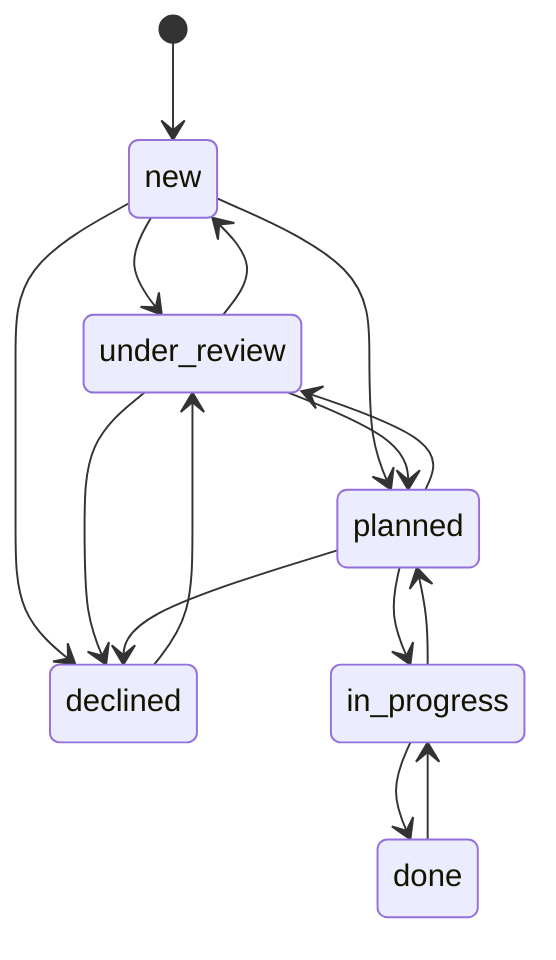

# Feedback Voting

A product-feedback module: users suggest improvements and upvote them, admins move ideas through a public roadmap and run votings ("what should we build next?"). Built with Laravel 12 + Sanctum and Vue 3 / Quasar.

> All data is synthetic: users at `example.test`, generated ideas, votes and ballots. Demo logins: `admin@example.test` and `member@example.test`, password `password`.

## What it demonstrates

| Topic | How |
|---|---|
| One vote per person, race-free | Composite primary key `(idea_id, user_id)` is the real guard. The denormalised `votes_count` changes in the same transaction under a row lock, so it cannot drift even with double clicks |
| Lifecycle rules | `IdeaStatus::allowedNext()` whitelists transitions (no "new → done"); every change is recorded with author and comment |
| Roadmap ordering | Reorder is accepted only if the submitted ids exactly match the column, so a stale browser tab gets a 409 instead of corrupting the order |
| Ballots | One ballot per voter per voting (unique key), 1..`max_choices` options, replaceable while open, withdrawable, idempotent |
| Fair results | Visibility per voting: `after_vote` (default, against the bandwagon effect), `after_close` or `always`. Admins always see the tally. Shares are % of voters, not % of choices |
| Duplicate prevention | "Similar ideas" suggestions while typing a new one (word-overlap similarity on normalised titles), so votes are not split across duplicates |
| Auth and abuse | Sanctum bearer tokens, `can:admin` gate, rate limits on login (per IP and email) and on new ideas (per user) |
| State without cron | A voting's state (scheduled, active, closed) is derived from its dates and `closed_at`, never stored, so it cannot go stale |

## Architecture



### Data model

```mermaid
erDiagram
    users ||--o{ ideas : authors
    users ||--o{ idea_votes : casts
    ideas ||--o{ idea_votes : receives
    ideas ||--o{ idea_status_changes : history
    users ||--o{ votings : creates
    votings ||--o{ voting_options : offers
    ideas |o--o{ voting_options : "may back"
    votings ||--o{ ballots : collects
    users ||--o{ ballots : "one per voting"
    ballots ||--o{ ballot_choices : picks
    voting_options ||--o{ ballot_choices : chosen

    ideas { string status int position "roadmap order" int votes_count "kept in sync" }
    idea_votes { pk idea_id_user_id }
    votings { timestamp starts_at timestamp ends_at timestamp closed_at int max_choices string results_visibility }
    ballots { uk voting_id_user_id }
```

### Idea lifecycle



Voting on ideas is closed in `done` and `declined`. Entering a roadmap column (planned, in progress, done) appends the idea to the end of that column.

## API

| Method | Endpoint | Who |
|---|---|---|
| POST | `/api/login` → `{token, user}` | public, rate limited |
| GET | `/api/me`, POST `/api/logout` | signed in |
| GET | `/api/ideas?status=&sort=top\|new&search=` | signed in |
| GET | `/api/ideas/similar?title=` | signed in |
| POST | `/api/ideas` | signed in, rate limited |
| GET | `/api/ideas/{id}` (with status history) | signed in |
| POST | `/api/ideas/{id}/vote` (toggle) | signed in |
| PATCH | `/api/ideas/{id}/status` `{status, comment}` | admin |
| GET | `/api/roadmap` | signed in |
| PUT | `/api/roadmap/order` `{status, ids[]}` | admin |
| GET | `/api/votings?state=`, `/api/votings/{id}` | signed in |
| PUT/DELETE | `/api/votings/{id}/ballot` `{option_ids[]}` | signed in |
| POST | `/api/votings` (options from ideas or free text) | admin |
| POST | `/api/votings/{id}/close` | admin |

## Running it

```bash
docker compose up -d --build
```

- UI: http://localhost:5176
- API: http://localhost:8083/api

The seeder creates:
- 42 users;
- 30 ideas with a long-tail vote distribution and status history;
- a roadmap;
- three votings: an active one with 26 ballots (the demo member has not voted yet), a closed one and a scheduled one.

## Tests

```bash
docker compose exec app vendor/bin/pest
```

The suite covers:
- auth: tokens, wrong credentials, login throttling, admin-only routes, logout revokes the token;
- ideas: submit, toggle vote and counter consistency across many voters, closed voting for finished ideas, sorting and filtering, similar-idea suggestions;
- status changes with history, forbidden transitions;
- roadmap ordering, stale reorder rejected;
- votings: validation, one replaceable ballot, the max-choices limit, foreign options, voting window, every visibility mode, shares and leader, withdrawal, early close and state filters;
- a seeder consistency check (counters equal the vote rows).

## Project layout

```
backend/app/
  Enums/       IdeaStatus (transitions), ResultsVisibility, Role
  Services/    IdeaService, SimilarIdeas, BallotService, VotingResults
  Http/Controllers/Api/  Auth, Idea, Roadmap, Voting
  Models/      User, Idea, IdeaStatusChange, Voting, VotingOption, Ballot
frontend/src/
  api/client.ts      stateless API layer + bearer token interceptor
  stores/auth.ts     session restore, admin flag
  pages/             Login, Ideas, Roadmap, Votings, Voting
```

## Out of scope

- Comments under ideas.
- Notifications when an idea you voted for changes status (the history is recorded, so this would be one listener).
- Merging duplicate ideas after the fact.
